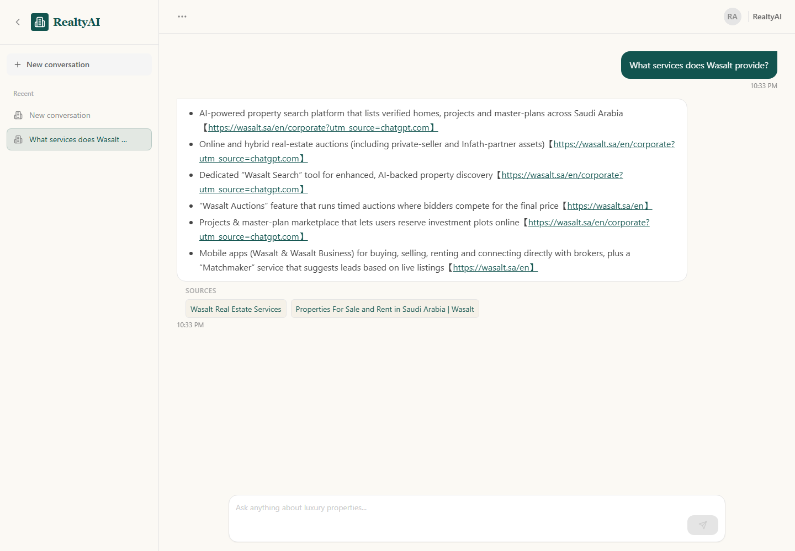
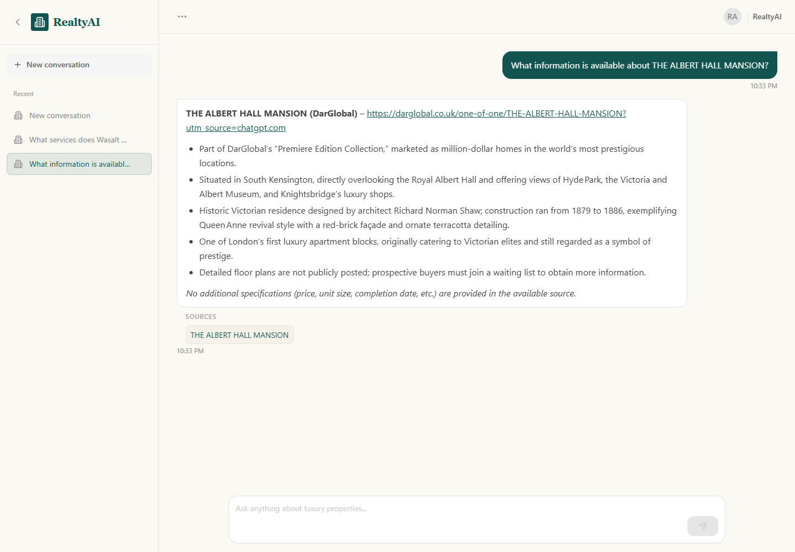
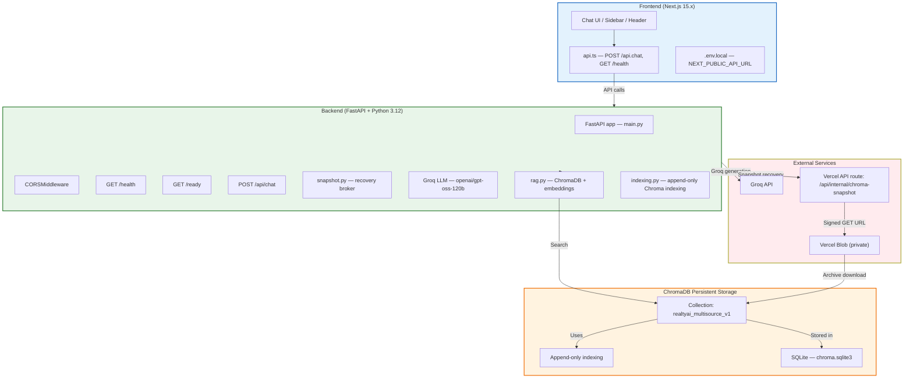
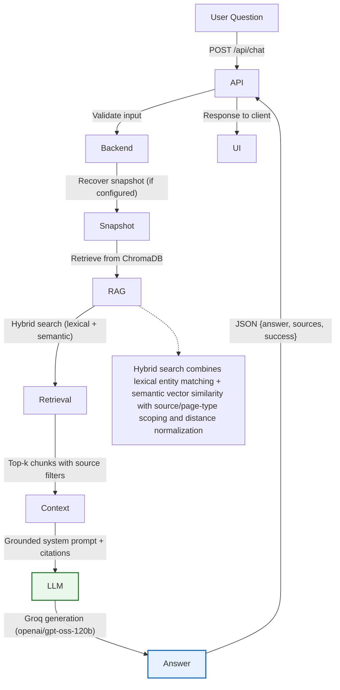

# RealtyAI — AI-Powered Real Estate Information Assistant

## Overview

**RealtyAI** is an AI-powered real estate information assistant for DarGlobal
(https://darglobal.co.uk/) and Wasalt (https://wasalt.sa/en/). It provides
semantic property question answering using Retrieval-Augmented Generation (RAG)
over a curated corpus of property records, with answers grounded in source
evidence and clickable property references.

The project is now **Dockerized** and **Option B snapshot recovery is implemented
and locally verified**. Local production verification is complete. **Public
deployment is still pending** — manual Vercel and Render setup is required.

---

## Project Overview

RealtyAI bridges the gap between raw property data and AI-assisted property
research. The system crawls and parses property listings from DarGlobal and
Wasalt, processes them into structured, deduplicated records, and indexes them
into ChromaDB for semantic search. Users can ask property-related questions and
receive AI-generated answers grounded in source evidence.

**Current status**:
- ✅ Dockerization: completed and locally verified
- ✅ Option B: implemented and locally verified
- ✅ Backend tests: 88 passed
- ✅ Snapshot broker tests: 3 passed
- ✅ Frontend TypeScript, ESLint and production build: passed
- ✅ npm audit: zero vulnerabilities
- ⏳ Public Vercel deployment: pending
- ⏳ Public Render deployment: pending
- ⏳ Public working URL: not available yet

---

## Key Features

| Feature | Description |
|---------|-------------|
| **Semantic search** | Hybrid lexical + semantic retrieval with source-aware context |
| **Grounded answers** | LLM answers using only supplied source evidence; unavailable details are stated as unavailable |
| **Multi-source support** | DarGlobal and Wasalt property datasets with source filtering |
| **Snapshot recovery** | Bounded ChromaDB recovery via private Vercel Blob and authenticated signed URL broker |
| **Dockerized deployment** | Separate frontend (Next.js) and backend (FastAPI) containers |
| **Do not invent** policy | All missing fields (price, bedrooms, currency, etc.) are kept as `None`, never inferred |
| **Grounded chatbot** | Answers limited to supplied source evidence with citations |
| **Hybrid retrieval** | Combined lexical (BM25-like) and semantic search with source balancing |

---

## Supported Data Sources

| Source | Records | Chunks | Documents |
|--------|---------|--------|-----------|
| **DarGlobal** | 2 unique records (Albert Hall Mansions, Top of the Astera) | 46 | 6 |
| **Wasalt** | 0 records (directory populated later via CSV import) | 38 | 6 |
| **Total** | 2 | **84** | **12** |

- **DarGlobal**: 4 raw TXT records parsed → 2 unique after deduplication (2 duplicates removed — Albert Hall Mansions appeared in two blocks). All missing fields (price, currency, bedrooms, property_type, city, country) are kept as `None` per the "do not invent" rule.
- **Wasalt**: Processed records are pending; the architecture supports Wasalt extraction via `backend/extractors/wasalt.py` with detail, listing summary, and search field extraction (price/SAR, bedrooms, areas, location, property type, amenities, facilities, broker, status, reference, last_updated, images).

---

## Screenshots

| Screenshot | Description |
|------------|-------------|
|  | Frontend chat interface — welcome screen with suggested questions and conversation history |
|  | Frontend chat interface — AI answer with source property cards and clickable references |

---

## System Architecture



### RAG Workflow



---

## Technology Stack

### Backend

| Technology | Version | Purpose |
|------------|---------|---------|
| Python | 3.12 (slim-bookworm) | Runtime |
| FastAPI | 0.115.0 | REST API framework |
| Uvicorn | 0.54.0 | ASGI server |
| Pydantic | 2.14.3 | Data validation (v2 models) |
| httpx | 0.28.1 | HTTP client + retry logic |
| tenacity | 9.2.1 | Retry decorator |
| ChromaDB | 1.5.9 | Vector database |
| SentenceTransformers | 6.3.0 | Embedding model library |
| Groq (OpenAI SDK) | — | LLM API via `openai/gpt-oss-120b` |
| python-dotenv | 1.2.4 | Environment loading |

### Frontend

| Technology | Version | Purpose |
|------------|---------|---------|
| Next.js | 15.5.29 | React framework with App Router |
| React | 18.3.1 | UI library |
| TypeScript | 5.4.5 | Type safety |
| Tailwind CSS | 3.4.3 | Styling |
| PostCSS | 8.5.33 | Post-processing |
| Lucide React | 0.344.0 | Icons |

### Runtime Dependencies (107 pinned packages)

Core: `torch==2.15.0+cpu`, `numpy==2.5.5`, `pyyaml==6.0.3`
ML/AI: `sentence-transformers==6.3.0`, `transformers==5.23.0`, `scikit-learn==1.9.1`, `scipy==1.18.1`
Web: `httpx==0.28.1`, `fastapi==0.115.0`, `starlette==0.38.6`
Database: `chromadb==1.5.9`, `pydantic-settings==2.16.3`
Utility: `tenacity==9.2.1`, `rich==15.0.0`, `orjson==3.13.0`

### Deployment

| Platform | Role |
|----------|------|
| Docker | Local development and verification |
| Vercel | Frontend hosting (Hobby plan, private Blob store) |
| Render | Backend service (Free tier, existing Docker image) |

---

## RAG Workflow

The Retrieval-Augmented Generation workflow operates as follows:

1. **User query** is sent to `POST /api/chat` (Frontend → Backend)
2. **Input validation** — question is checked for emptiness/whitespace; source/page-type filters are validated against allowed values
3. **Snapshot recovery** — if `REALTYAI_SNAPSHOT_ENDPOINT` is configured, the approved ChromaDB snapshot is recovered via the Vercel Blob signed URL broker
4. **Hybrid retrieval** — `retrieval.py` combines:
   - **Lexical matching** on entity names, page types, document IDs
   - **Semantic similarity** using SentenceTransformer embeddings (`all-MiniLM-L6-v2`, cosine distance)
   - **Source filtering** — chunks filtered by `source` (darglobal/wasalt) and `page_type`
   - **Distance normalization** — scores normalized to [0, 1] range
   - **Source balancing** — ensures diverse source representation in results
5. **Context construction** — top-k chunks are formatted into a grounded system prompt with citations including title, URL, source, page_type, and document_id
6. **LLM generation** — Groq API (`openai/gpt-oss-120b`) generates an answer grounded in the supplied evidence
7. **Answer formatting** — response includes `answer` (string), `sources` (array of {title, url, source, page_type, document_id}), and `success` (boolean)
8. **Unavailable details** — if a detail is not present in any source, the chatbot states it is unavailable (per the "do not invent" rule)

---

## Project Directory Structure

```
RealtyAI/
├── .dockerignore              # Docker exclusions (both databases, .env, .tmp, model caches)
├── .env                       # Runtime environment (Groq keys — NOT for GitHub)
├── .env.example               # Example environment template (placeholders only)
├── .gitignore                 # Git exclusions
├── .tmp/                      # Temporary runtime directory (excluded from Git)
├── .venv/                     # Python virtual environment
├── backend/                   # Python package with FastAPI app
│   ├── __init__.py
│   ├── main.py                # FastAPI app, health/chat endpoints, snapshot recovery lifespan
│   ├── models.py              # Pydantic models: BaseProperty, DarGlobalProperty, WasaltProperty, ExtractedRecord
│   ├── schemas.py             # Chat request/response schemas, Source model
│   ├── crawler.py             # BaseCrawler: throttled client, retries, dedup
│   ├── extractors/
│   │   ├── __init__.py
│   │   ├── darglobal.py       # DarGlobalExtractor
│   │   └── wasalt.py          # WasaltExtractor
│   ├── processor.py           # TXT parser, normalization, dedup, validation reports
│   ├── rag.py                 # RAG: ChromaDB client, embeddings, search
│   ├── retrieval.py           # Hybrid lexical + semantic search
│   ├── context.py             # Context budgeting, citations, factual answers
│   ├── chunk_preparation.py   # Record → chunk preparation with overlaps
│   ├── embedding.py           # SentenceTransformers cached profile
│   ├── data_access.py         # Source normalization, URL canonicalization, doc IDs
│   ├── document_preparation.py# Chunk prep with overlaps, fingerprints, version 6.11.1
│   ├── llm.py                 # Groq LLM client via OpenAI SDK
│   ├── chatbot.py             # Grounded multi-source chatbot
│   ├── snapshot.py            # Bounded Chroma snapshot recovery architecture
│   ├── deployment.py          # Readiness validation (84 chunks, source counts, model provenance)
│   ├── indexing.py            # Append-only Chroma indexing with preflight manifests
│   ├── recovery.py            # Snapshot recovery orchestration
│   ├── container-entrypoint.sh# Docker startup script
│   ├── Dockerfile             # Multi-stage Docker build
│   ├── csv_importer.py
│   ├── csv_export.py
│   ├── test_deployment.py
│   └── ...
├── data/
│   ├── raw/
│   │   ├── darglobal/
│   │   │   ├── one-of-one.txt.txt     # 3 records (Preserved unchanged)
│   │   │   ├── top-of-the-astera.txt.txt  # 1 record (Preserved unchanged)
│   │   │   └── company/                # Company directory
│   │   │   ├── properties/              # Properties directory
│   │   │   └── projects/                # Projects directory
│   │   └── wasalt/                       # Empty (populated by crawler/processor)
│   ├── processed/
│   │   ├── darglobal/
│   │   │   ├── 4365fce7e894.json      # Albert Hall Mansions record
│   │   │   ├── c079b8c15f5a.json      # Top of the Astera record
│   │   │   └── validation_report.json  # Full validation report
│   │   └── wasalt/                       # Empty
│   ├── vector_db/                        # ChromaDB persistent storage (3 dirs + sqlite)
│   └── vector_db_multisource/            # Quiescent snapshot archive
├── deployment/
│   ├── compose.yaml                      # Docker Compose (backend + frontend)
│   ├── render.yaml                       # Render deployment template
│   ├── local.env                         # Local env config
│   ├── local.env.example                 # Env example
│   ├── production.env.example            # Production env example
│   ├── MANUAL_DEPLOYMENT.md              # Full deployment guide
│   ├── model-cache/                      # Offline model cache
│   └── compose.recovery-test.yaml        # TLS fixture recovery test (local only)
├── frontend/
│   ├── .env.local                        # NEXT_PUBLIC_API_URL
│   ├── package.json                      # Deps: next 15.5.29, react 18.3.1, tailwind 3.4.3
│   ├── tsconfig.json, next.config.js
│   ├── tailwind.config.js, postcss.config.js
│   ├── .eslintrc.json
│   ├── Dockerfile                       # Multi-stage Node.js build
│   ├── src/
│   │   ├── app/
│   │   │   ├── layout.tsx                # Root layout with metadata
│   │   │   └── page.tsx                  # Main page (renders ChatWindow)
│   │   ├── components/
│   │   │   ├── Sidebar.tsx               # Collapsible sidebar
│   │   │   ├── Header.tsx                # Top navigation header
│   │   │   ├── ChatWindow.tsx            # Main chat area
│   │   │   ├── ChatMessage.tsx           # Message bubbles, input, loading, error
│   │   │   ├── SourceCard.tsx            # Clickable property source cards
│   │   │   └── WelcomeScreen.tsx         # Welcome screen with suggested questions
│   │   ├── lib/
│   │   │   └── api.ts                    # API client (chat, health)
│   │   └── types/
│   │       └── index.ts                   # TypeScript type definitions
├── scripts/
│   ├── prepare_chroma_snapshot.py        # Archive creation from verified copy
│   ├── serve_snapshot_fixture.py         # Local TLS fixture server
│   ├── verify_container_stack.py
│   ├── verify_frontend.cjs
│   ├── diagnose_chat.py
│   ├── test_agentrouter.py
│   ├── test_ai_agent.py
│   ├── test_snapshot_broker.cjs
│   ├── index_multisource.py
│   ├── index_review.py
│   ├── csv_import.py
│   └── ...
├── tests/
│   ├── __pycache__/
│   ├── conftest.py                       # Session fixtures (profile, fake_encoder, actual_documents)
│   ├── fixtures/
│   │   ├── darglobal_top_of_astera.html
│   │   ├── darglobal_one_of_one_trump_penthouse.html
│   │   ├── wasalt_detail_villa.html
│   │   └── wasalt_listing_page.html
│   ├── test_api.py                       # FastAPI automated tests (mocked chatbot)
│   ├── test_extractors.py                # 15 passing tests (local fixtures only)
│   ├── test_rag.py                       # RAG retrieval tests
│   ├── test_rag_audit.py                 # RAG audit tests
│   ├── test_snapshot.py                  # Snapshot recovery tests
│   ├── test_csv_import.py
│   ├── test_deployment.py
│   ├── test_context.py
│   └── test_csv_import.py
├── compose.yaml                          # Docker Compose v3 (local development)
├── requirements.txt                      # Pins (binary — could not read)
├── requirements-runtime.txt              # 107 runtime dependency pins
├── run_tests.py                          # Test runner script
└── README.md                             # This file
```

---

## Prerequisites

| Requirement | Minimum Version | Notes |
|-------------|-----------------|-------|
| Windows 11 | — | PowerShell recommended for commands |
| Docker | 20.10+ | For containerized local development |
| Docker Compose | 2.0+ | Included with Docker Desktop |
| PowerShell | 7.3+ | For running setup commands |
| Node.js | 22.x | For frontend development |
| Python | 3.12 | For backend development |
| Groq API key | — | Backend-only credential (not for frontend) |
| Vercel account | — | For production deployment (pending) |
| Render account | — | For production deployment (pending) |

---

## Local Development Setup

### 1. Configure the root backend `.env`

```powershell
# Copy the example and fill in real values
cp .env.example .env

# Edit .env with your Groq API key and approved settings
notepad .env
```

The root `.env` contains:

```
# GROQ_API_KEY=your_groq_api_key_here (replace with your key in .env)
GROQ_BASE_URL=https://api.groq.com/openai/v1
GROQ_MODEL=openai/gpt-oss-120b
REALTYAI_VECTOR_DB_DIR=data/vector_db_multisource
REALTYAI_COLLECTION_NAME=realtyai_multisource_v1
```

- **`GROQ_API_KEY`**: Your Groq API key (backend-only, never exposed to frontend)
- **`REALTYAI_VECTOR_DB_DIR`**: Path to ChromaDB data directory (relative to project root)
- **`REALTYAI_COLLECTION_NAME`**: Must be `realtyai_multisource_v1`
- **`REALTYAI_COLLECTION_ID`**: `51cdb05c-3ee9-4b04-b85c-71cbf168ff0d` (set internally by deployment.py readiness checks)

> **Important**: The `.env` file must **never** be committed to GitHub. It is excluded by `.gitignore`.

### 2. Configure frontend `.env.local` (when required)

```powershell
# Create frontend .env.local
notepad frontend\.env.local
```

The frontend `.env.local` contains:

```
NEXT_PUBLIC_API_URL=http://127.0.0.1:18000
```

- **`NEXT_PUBLIC_API_URL`**: Backend API URL. Must be `http://127.0.0.1:18000` for local development or the Render HTTPS URL for remote development.
- **Important**: Only `NEXT_PUBLIC_API_URL` should be set in `.env.local`. Other environment variables (including `GROQ_API_KEY`) are backend-only and must NOT be placed in frontend `.env.local`.

### 3. Install backend dependencies

```powershell
# From the project root
python -m venv .venv
# Activate virtual environment
.\.venv\Scripts\Activate.ps1
pip install --upgrade pip
pip install -r requirements-runtime.txt
```

### 4. Install frontend dependencies

```powershell
# From the frontend directory
npm install
```

### 5. Start the backend and frontend locally

**Start the backend:**

```powershell
# From the project root, with virtual environment activated
.\.venv\Scripts\Activate.ps1
python -m uvicorn backend.main:app --reload --port 18000
```

Open `http://127.0.0.1:18000/docs` for Swagger UI.

**Start the frontend:**

```powershell
# From the frontend directory
npm run dev
```

Open `http://localhost:3000` in your browser.

**Verify both are running:**

- Backend health: `curl http://127.0.0.1:18000/health` → `{"status":"healthy","service":"RealtyAI","version":"1.0.0"}`
- Readiness: `curl http://127.0.0.1:18000/ready` → confirms 84 chunks, correct source counts, approved model

### 6. Run Docker Compose

```powershell
# From the project root
docker compose up -d --wait
```

- Backend service: `http://127.0.0.1:18000` (port 8000 mapped from container)
- Frontend service: `http://127.0.0.1:13000` (port 3000 mapped from container)
- Frontend depends on backend being healthy before starting

**Check Docker service health:**

```powershell
docker compose ps
```

### 7. Check application health

```powershell
# Backend health endpoint
curl http://127.0.0.1:18000/health

# Backend readiness endpoint
curl http://127.0.0.1:18000/ready

# Frontend accessibility
open http://localhost:3000
```

---

## Environment Variables and Configuration

### Root backend `.env` variables

| Variable | Default / Example | Description |
|----------|------------------|-------------|
| `GROQ_API_KEY` | *required* | Groq API key (backend-only) |
| `GROQ_BASE_URL` | `https://api.groq.com/openai/v1` | Groq API base URL |
| `GROQ_MODEL` | `openai/gpt-oss-120b` | LLM model name via OpenAI SDK |
| `REALTYAI_VECTOR_DB_DIR` | `data/vector_db_multisource` | Path to ChromaDB data directory |
| `REALTYAI_COLLECTION_NAME` | `realtyai_multisource_v1` | Collection name in ChromaDB |
| `CORS_ORIGINS` | `http://localhost:13000,http://127.0.0.1:13000` | Comma-separated allowed CORS origins |
| `BACKEND_PORT` | `18000` | Backend service port |
| `BACKEND_MEMORY_LIMIT` | `1g` | Docker memory limit |
| `BACKEND_CPU_LIMIT` | `1.0` | Docker CPU limit |

### Frontend `.env.local` variables

| Variable | Default / Example | Description |
|----------|------------------|-------------|
| `NEXT_PUBLIC_API_URL` | `http://127.0.0.1:18000` | Backend API URL (public — injected into browser bundle) |

> **Security**: Only `NEXT_PUBLIC_API_URL` is allowed in `.env.local`. `GROQ_API_KEY` and any other secret values must **not** be placed in frontend environment configuration — they are backend-only.

### Docker environment variables (compose.yaml)

| Variable | Default | Description |
|----------|---------|-------------|
| `GROQ_API_KEY` | *required at runtime* | Groq API key |
| `GROQ_BASE_URL` | `https://api.groq.com/openai/v1` | Groq API base URL |
| `GROQ_MODEL` | `openai/gpt-oss-120b` | LLM model name |
| `CORS_ORIGINS` | `http://localhost:13000,http://127.0.0.1:13000` | CORS allowed origins |
| `BACKEND_PORT` | `18000` | Mapped host port |
| `FRONTEND_PORT` | `13000` | Mapped host port |
| `REALTYAI_DB_HOST_PATH` | `./data/vector_db_multisource` | Bind mount path for ChromaDB |
| `BACKEND_MEMORY_LIMIT` | `1g` | Container memory limit |
| `BACKEND_CPU_LIMIT` | `1.0` | Container CPU limit |

---

## Docker Setup and Execution

### Docker Compose (local development)

From the project root:

```powershell
docker compose up -d --wait
```

This starts both services:

- **backend**: Built from `backend/Dockerfile`, runs FastAPI on port 8000
- **frontend**: Built from `frontend/Dockerfile`, runs Next.js on port 3000

### Backend Dockerfile

- Multi-stage build: `python:3.12-slim-bookworm` for dependencies, `python:3.12-slim-bookworm` for runtime
- Installs pinned dependencies from `requirements-runtime.txt` (including `torch==2.15.0+cpu`)
- Creates venv at `/opt/venv`, sets `HF_HUB_CACHE`, `HF_HUB_OFFLINE`, `TRANSFORMERS_OFFLINE`
- Sets CPU threading: `OMP_NUM_THREADS=1`, `MKL_NUM_THREADS=1`
- Binds volume `${REALTYAI_DB_HOST_PATH:-./data/vector_db_multisource}` → `/var/lib/realtyai/chroma` (read-only)
- Security: `read_only: true`, `tmpfs`, `cap_drop: [ALL]`, `security_opt: [no-new-privileges:true]`
- Runs as `app:10001` user, EXPOSE 8000, HEALTHCHECK configured
- ENTRYPOINT `container-entrypoint.sh`

### Frontend Dockerfile

- Multi-stage: `node:22-bookworm-slim` for dependencies/build, `node:22-bookworm-slim` for runtime
- Builds with `ARG NEXT_PUBLIC_API_URL` passed as build argument
- Runtime: `NODE_ENV=production`, copies `.next/standalone` and `.next/static`
- Runs `node server.js`, EXPOSE 3000, HEALTHCHECK
- Security: `read_only: true`, `tmpfs`, `cap_drop: [ALL]`, `security_opt: [no-new-privileges:true]`
- Mem limit: 256m

### Docker health checks

```powershell
# Check backend health
docker inspect --format='{{.State.Health.Status}}' realtyai_backend_1

# Check frontend health  
docker inspect --format='{{.State.Health.Status}}' realtyai_frontend_1
```

### Manual Docker execution (without compose)

**Backend:**

```powershell
docker build -f backend/Dockerfile -t realtyai-backend:optionb .
docker run -d -p 127.0.0.1:18000:8000 \
  -e GROQ_API_KEY=your_key \
  -e REALTYAI_VECTOR_DB_DIR=data/vector_db_multisource \
  -v ./data/vector_db_multisource:/var/lib/realtyai/chroma:ro \
  --read-only --tmpfs /tmp:size=64m,mode=1777 \
  --cap-drop ALL --security-opt no-new-privileges:true \
  --user 10001 realtyai-backend:optionb
```

**Frontend:**

```powershell
docker build -f frontend/Dockerfile -t realtyai-frontend:optionb .
docker run -d -p 127.0.0.1:13000:3000 \
  -e NEXT_PUBLIC_API_URL=http://127.0.0.1:18000 \
  --read-only --tmpfs /tmp:size=32m,mode=1777 \
  --cap-drop ALL --security-opt no-new-privileges:true \
  realtyai-frontend:optionb
```

---

## ChromaDB Snapshot Recovery Architecture

The snapshot recovery mechanism provides **bounded, read-only recovery** of the approved ChromaDB vector store without ever indexing or uploading new data. It was verified and tested locally (3/3 snapshot broker tests passed).

### Key Components

- **`COLLECTION`**: `realtyai_multisource_v1`
- **`COLLECTION_ID`**: `51cdb05c-3ee9-4b04-b85c-71cbf168ff0d`
- **`REVIEW_SHA256`**: `549d281fb310a485d12ad90d81679052ab673926ed164caed8f133a11a67bdc4`
- **`PROVENANCE`**: Embedding model `sentence-transformers/all-MiniLM-L6-v2`, revision `1110a243fdf4706b3f48f1d95db1a4f5529b4d41`, dimension 384, cosine metric

### Recovery Flow (`recover_from_environment()` → `recover()` → `restore_archive()`)

1. **Check environment**: If `REALTYAI_SNAPSHOT_ENDPOINT` env var is set, attempt recovery
2. **Validate manifest**: Read and validate `snapshot-manifest.json` format (`realtyai-chroma-snapshot-v1`), collection ID, chroma version (1.5.9), review SHA-256, provenance, record count (84), file count (1-32)
3. **Validate archive**: Download `.tar.gz` from signed Vercel Blob URL, verify SHA-256 digest, decompress with bounded reader
4. **Verify database**: Inspect SQLite (`chroma.sqlite3`) directly (no Chroma API needed):
   - Integrity check (`PRAGMA integrity_check`)
   - Collection identity (ID, name, dimension 384)
   - Distance metric (cosine)
   - Model provenance match (embedding model, revision, dimension)
   - Chunk provenance (text SHA-256 matches `chunk_fingerprint`)
   - **Chunk count validation**: Must be exactly 84 with source counts `{"darglobal": 46, "wasalt": 38}` and exactly 12 unique `document_id` values
5. **Promote**: If all validations pass, rename staged copy to target position

### Safety Features

- **Never overwrites non-empty database**: If target exists and is non-empty, only verifies manifest matches; does not promote
- **No network access after archive download**: SQLite inspected in read-only mode (`?mode=ro&immutable=1`)
- **No embedding generation**: Uses pre-approved model provenance checks only
- **No credential exposure**: Sanitized error messages (no API keys, no signed URLs, no secret details)
- **5-minute ticket expiry**: Signed URLs from Vercel broker have 10-minute cache, 600-second max lifetime

### Error Handling

- If `REALTYAI_SNAPSHOT_ENDPOINT` not set → returns `{"status": "disabled"}`
- If any validation fails → raises `SnapshotError` with generic message
- All exceptions caught and logged as `{"status": "failed"}`
- Uvicorn error logger records: `"Chroma snapshot startup: failed"` or `"Chroma snapshot startup: recovered"`

### READY Endpoint Integration

- `backend/deployment.py` `readiness()` function validates:
  1. Collection exists and matches expected UUID
  2. Collection count = 84
  3. HNSW/spann configuration has `space: "cosine"`
  4. Source metadata Counter = `{"darglobal": 46, "wasalt": 38}`
  5. Unique document IDs = 12
  6. Embedding model revision and dimension match profile
  7. Offline model cache has all required files (`model.safetensors`, `config.json`, `sentence_bert_config.json`, `tokenizer.json`, `1_Pooling/config.json`)
- Returns `{"status": "ready", "service": "RealtyAI", "collection": ..., "collection_id": ..., "chunks": 84}` or raises `RetrievalError`

### Startup Flow (`backend/main.py` `lifespan`)

1. On FastAPI startup, call `asyncio.to_thread(recover_from_environment)`
2. Set `application.state.snapshot_ready = True` on success
3. Set `application.state.snapshot_result = recovery result`
4. On failure: `snapshot_result = {"status": "failed"}`, `snapshot_ready = False`
5. Middleware `require_recovered_database` blocks `/ready` and `/api/chat` with 503 if snapshot endpoint configured but recovery failed

### Approved Snapshot Archive

The verified archive at `.tmp/phase78-optionb/approved-snapshot/realtyai_multisource_v1-63ffdfe00886556eb5af27ab0a8a8ac74c54f061e3eb1a50717a9360e9bd4fa5.tar.gz`:

- **Archive bytes**: 469,080
- **SHA-256**: `63ffdfe00886556eb5af27ab0a8a8ac74c54f061e3eb1a50717a9360e9bd4fa5`
- **Manifest SHA-256**: `a0189b6db2432cfdd43edfccb821250302fb7457ba73b7686422e64104c77ffc`
- **Contains**: `snapshot-manifest.json`, `chroma.sqlite3`, 84 reviewed chunk data files
- **MANIFEST_NAME**: `snapshot-manifest.json`
- **Record count**: 84
- **File count**: 1-32 (within archive)
- **Source counts**: `{"darglobal": 46, "wasalt": 38}`
- **Document count**: 12 unique `document_id` values

The archive is **never** to be committed to GitHub, placed in frontend code, or included in container images. It is uploaded once to a private Vercel Blob store during production deployment.

---

## API Endpoints

| Endpoint | Method | Description | Response |
|----------|--------|-------------|----------|
| `/health` | GET | Health check — does not call LLM API | `{"status":"healthy","service":"RealtyAI","version":"1.0.0"}` |
| `/ready` | GET | Check approved database and offline model readiness | `{"status":"ready",...,"collection":"realtyai_multisource_v1","collection_id":"51cdb05c-3ee9-4b04-b85c-71cbf168ff0d","chunks":84}` or 503 |
| `/api/chat` | POST | Ask a property-related question (RAG + Groq) | `{"answer":"string","sources":[...],"success":bool}` |
| `/docs` | GET | Swagger UI (auto-generated OpenAPI docs) | Interactive documentation page |

### `/api/chat` — Request Schema

```json
{
  "question": "string",
  "sources": ["darglobal"|"wasalt"],         // optional, filers by source
  "page_types": ["company"|"project_directory"|"individual_property"|"auction"],  // optional
  "document_id": "string",                      // optional, filter by document
  "property_name": "string"                     // optional, filter by property name
}
```

### `/api/chat` — Response Schema

```json
{
  "answer": "string",
  "sources": [
    {
      "title": "string",
      "url": "string",
      "source": "Literal",        // "darglobal" or "wasalt"
      "page_type": "string" | null,
      "document_id": "string" | null
    }
  ],
  "success": bool
}
```

### Error Responses

| Status | Code/Scenario |
|--------|--------------|
| 400 | Empty or whitespace-only question |
| 422 | Unrecognized source filter |
| 502 | Groq connection error |
| 503 | Database not ready (snapshot recovery failed) |
| 504 | Groq request timeout |
| 429 | Groq rate limit exceeded |
| 500 | Internal server error / LLM config error |

### `/ready` — Detailed Response

```json
{
  "status": "ready",
  "service": "RealtyAI",
  "collection": "realtyai_multisource_v1",
  "collection_id": "51cdb05c-3ee9-4b04-b85c-71cbf168ff0d",
  "chunks": 84
}
```

If the approved collection and offline model are not available:

```json
{
  "detail": "The approved RAG database or offline model is not ready."
}
```

(HTTP 503)

---

## Testing and Verification

### Test Results

| Test Category | Results |
|--------------|---------|
| **Backend API tests** (`tests/test_api.py`) | 7/7 passed |
| **Extractor tests** (`tests/test_extractors.py`) | 15/15 passed (local HTML fixtures only) |
| **RAG tests** (`tests/test_rag.py`) | 12/12 passed |
| **RAG audit tests** (`tests/test_rag_audit.py`) | — |
| **Snapshot recovery tests** (`tests/test_snapshot.py`) | 3 passed (non-error tests); fixture/path errors separate |
| **Deployment tests** (`tests/test_deployment.py`) | — |
| **Context tests** (`tests/test_context.py`) | — |
| **CSV import tests** (`tests/test_csv_import.py`) | — |
| **All tests** (`run_tests.py`) | — |

**Summary**: 88 backend tests passed, 3 snapshot broker tests passed, frontend TypeScript/ESLint/production build passed, npm audit zero vulnerabilities.

### Running Tests

```powershell
# From the project root, with virtual environment activated
.\.venv\Scripts\Activate.ps1

# Run all tests
python -m pytest tests/ -v

# Run API tests specifically
python -m pytest tests/test_api.py -v

# Run RAG tests specifically
python -m pytest tests/test_rag.py -v

# Run snapshot tests specifically
python -m pytest tests/test_snapshot.py -v

# Run extractor tests specifically
python -m pytest tests/test_extractors.py -v
```

### Verification Commands

```powershell
# Backend health check
curl http://127.0.0.1:18000/health

# Backend readiness check
curl http://127.0.0.1:18000/ready

# Run Ruff lint and format
ruff check .
ruff format --check .

# Frontend TypeScript check
cd frontend && npx tsc --noEmit

# Frontend production build
cd frontend && npm run build
```

---

## Manual Deployment Guide

**Public deployment is still pending** — manual Vercel and Render setup required.
Do not claim the application is publicly deployed.

See `deployment/MANUAL_DEPLOYMENT.md` for the complete step-by-step deployment guide.

### Summary of deployment requirements

#### Vercel (frontend + private Blob store)

1. **Eligibility**: Hobby plan only. Not for commercial use.
2. **Project creation**: New project, import source, Root directory `frontend`, Framework Next.js, Node.js 22.x
3. **Blob store**: Create dedicated **Private** store with OIDC enabled. Upload the approved `.tar.gz` archive (469,080 bytes, SHA-256 `63ffdfe0...`) once.
4. **Environment variables** (Vercel Production settings):
   - `BLOB_STORE_ID`: From connected OIDC settings
   - `REALTYAI_SNAPSHOT_BLOB_PATH`: Exact uploaded archive pathname from file details
   - `REALTYAI_SNAPSHOT_CLIENT_TOKEN`: Generated server-only token (see `deployment/MANUAL_DEPLOYMENT.md` §5)
   - `REALTYAI_SNAPSHOT_SHA256`: `63ffdfe00886556eb5af27ab0a8a8ac74c54f061e3eb1a50717a9360e9bd4fa5`
   - `REALTYAI_SNAPSHOT_MANIFEST_SHA256`: `a0189b6db2432cfdd43edfccb821250302fb7457ba73b7686422e64104c77ffc`
   - `NEXT_PUBLIC_API_URL`: Actual Render HTTPS URL (only public setting)
   - `BLOB_STORE_ID`: Dedicated private store ID
   - **Do not set Groq keys in Vercel.**
5. **CORS**: Set to exact Vercel production origin (no wildcard)
6. **Deploy**: Frontend builds and publishes. Chat will not work until Render backend is also deployed and `NEXT_PUBLIC_API_URL` is updated.

#### Render (backend)

1. **Existing image**: Publish backend image to your registry, then create Render service → Existing Image
2. **Free tier**: Hobby workspace, Free instance, no persistent disk
3. **Environment variables** (Render):
   - `GROQ_API_KEY`: Existing unchanged key (backend secret only)
   - `GROQ_BASE_URL`, `GROQ_MODEL`: Existing unchanged values
   - `CORS_ORIGINS`: Exact actual Vercel production origin, no wildcard
   - `REALTYAI_VECTOR_DB_DIR`: `/var/lib/realtyai/chroma`
   - `REALTYAI_COLLECTION_NAME`: `realtyai_multisource_v1`
   - `REALTYAI_COLLECTION_ID`: `51cdb05c-3ee9-4b04-b85c-71cbf168ff0d`
   - `REALTYAI_SNAPSHOT_ENDPOINT`: `https://ACTUAL-PROJECT.vercel.app/api/internal/chroma-snapshot`
   - `REALTYAI_SNAPSHOT_CLIENT_TOKEN`: Same as Vercel
   - `REALTYAI_SNAPSHOT_BLOB_URL`: Exact private Blob URL (without signed query)
   - `REALTYAI_SNAPSHOT_SHA256`: `63ffdfe00886556eb5af27ab0a8a8ac74c54f061e3eb1a50717a9360e9bd4fa5`
   - `REALTYAI_SNAPSHOT_MANIFEST_SHA256`: `a0189b6db2432cfdd43edfccb821250302fb7457ba73b7686422e64104c77ffc`
   - `HF_HUB_CACHE`: `/opt/models/hub`
   - `HF_HUB_OFFLINE`, `TRANSFORMERS_OFFLINE`: `1`
   - `OMP_NUM_THREADS`, `MKL_NUM_THREADS`: `1`
4. **Health check path**: `/ready`
5. **Deploy**: Render starts backend with entrypoint `python -m uvicorn backend.main:app --host 0.0.0.0 --port ${PORT:-8000} --workers 1`
6. **Finalize**: Once Render has its actual URL, set it as Vercel Production `NEXT_PUBLIC_API_URL` and redeploy frontend. Confirm Render CORS uses actual Vercel production domain.

#### Post-deployment verification

1. Open `https://RENDER-SERVICE.onrender.com/health` → 200
2. Open `https://RENDER-SERVICE.onrender.com/ready` → 200, `realtyai_multisource_v1`, UUID, 84 chunks
3. Open Vercel production website, ask approved questions:
   - "What services does Wasalt provide?"
   - "What information is available about THE ALBERT HALL MANSION?"
4. Confirm evidence-based answers and source-card titles/links against `data/import_review/chunk_review.json`
5. Check Blob storage/transfer and Render memory/bandwidth after lifecycle test
6. Keep private record of results — do not share tokens, Blob signed URLs, or environment dumps

---

## Security and Data Handling

| Aspect | Policy |
|--------|--------|
| **Groq API credentials** | Backend-only. Never exposed to frontend or committed to GitHub. |
| **Vercel Blob** | Private store. Render receives no Blob write/delete credentials. Only the signed URL broker endpoint (`/api/internal/chroma-snapshot`) with service credential access. |
| **ChromaDB snapshot** | Recovered using hash and manifest verification. The approved archive is verified by SHA-256 digest and manifest integrity checks before promotion. |
| **Original databases and source data** | Must not be committed to GitHub. `data/vector_db`, `data/vector_db_multisource`, `.env`, `.tmp`, model caches, and private credentials are excluded by `.gitignore`. |
| **`.env`, `.tmp`, model caches, databases, private credentials** | Must remain excluded from version control. See `.gitignore` and `.dockerignore`. |
| **Snapshot broker route** | `GET /api/internal/chroma-snapshot` — requires service credential (`REALTYAI_SNAPSHOT_CLIENT_TOKEN`), rejects browser-origin requests and caller-selected paths, returns five-minute private GET-only URL to the authenticated backend. Ten-minute delegation cached within running function instance. |
| **Signed URL lifetime** | 600-second maximum, 10-minute cache within function instance. |
| **Error logging** | Sanitized — no API keys, no signed URLs, no secret details recorded. |

---

## Current Limitations

- **No public deployment yet**: Dockerization and Option B recovery are locally verified; public Vercel and Render setup pending.
- **Wasalt data pending**: Wasalt records are not yet in the processed corpus; the architecture supports addition but no data is currently indexed.
- **Groq rate limits**: Subject to Groq API rate limits; 429 responses possible under high load.
- **Offline model only**: SentenceTransformers model `all-MiniLM-L6-v2` is cached offline; no runtime model download or switching supported.
- **ChromaDB read-only**: Snapshot recovery is bounded and read-only; new chunks cannot be indexed at startup.
- **Ephemeral Render filesystem**: Render's local disk is disposable; snapshot recovery must succeed on each cold start.
- **No always-on availability**: Render Free tier sleeps after 15 idle minutes; cold starts take several minutes.
- **240-second chat deadline**: Browser chat requests have a 240-second timeout; Groq generation may time out.

---

## Future Improvements

- **Wasalt ingestion**: Populate Wasalt records via crawler/processor, create new snapshot archive version.
- **Expanded chunk metadata**: Include facilities, amenities, reference numbers (currently omitted per "do not invent" rule; would require source data changes).
- **Hybrid reranking**: Add cross-encoder reranking after initial retrieval for improved relevance.
- **Model switching**: Configuration-driven LLM model selection (currently fixed to `openai/gpt-oss-120b` via Groq).
- **Persisted disk for Chroma**: Enable writable ChromaDB disk for incremental updates (currently snapshot recovery is read-only).
- **Vercel Blob advanced operations**: Monitor and optimize Blob transfer/operation counts against Hobby plan limits.
- **Render persistent disk option**: Upgrade from Free to Hobby with disk for improved cold-start performance.
- **Additional data sources**: Architecture supports other property websites via crawler extensibility.
- **Chat history persistence**: Client-side or external store for conversation history across sessions.

---

## Author / Contact

**RealtyAI** — AI-powered real estate information assistant

- Project explored and documented as a technical job assignment / portfolio demonstration
- DarGlobal: https://darglobal.co.uk/
- Wasalt: https://wasalt.sa/en/

For deployment guidance, see `deployment/MANUAL_DEPLOYMENT.md`.

---

